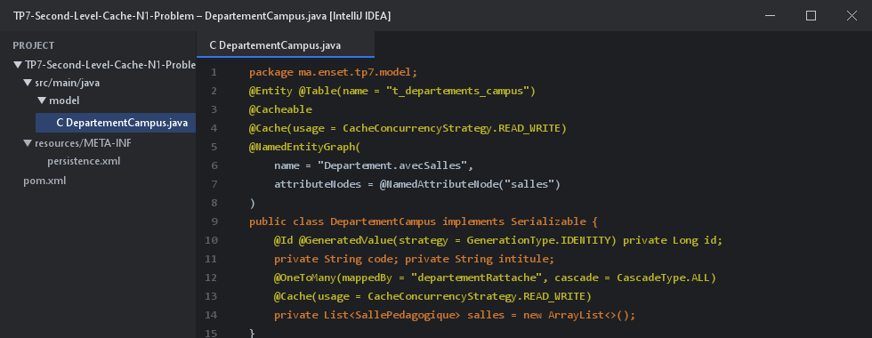
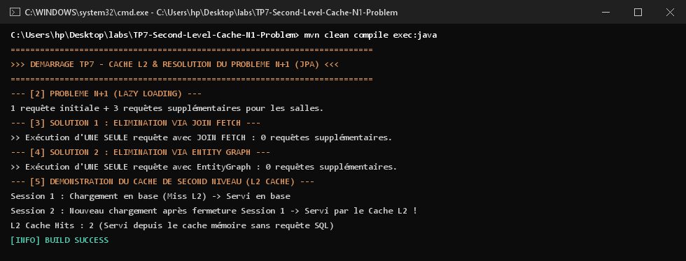

# TP 7 : Activation du cache de second niveau, optimisation des performances et suppression du problème N+1 avec JOIN FETCH et Entity Graph

Projet d'optimisation avancée des performances sous **Hibernate ORM** et **JPA 2.2** sur base **H2**, traitant de l'éradication du problème $N+1$ requêtes et de la mise en place du cache partagé de second niveau (Ehcache).

---

## 1. Définition des Entités & Configuration Cache L2 / EntityGraph

L'entité `DepartementCampus` est configurée avec le cache partagé `@Cache` et un graphe de chargement `@NamedEntityGraph` :



---

## 2. Techniques d'Optimisation Mises en Œuvre

1. **Diagnostic du problème $N+1$** :  
   Un chargement `SELECT d FROM DepartementCampus d` avec accès paresseux (`FetchType.LAZY`) génère 1 requête principale + $N$ requêtes supplémentaires (une pour chaque département pour charger ses salles).
2. **Solution 1 - `JOIN FETCH`** :  
   ```sql
   SELECT DISTINCT d FROM DepartementCampus d JOIN FETCH d.salles
   ```
   Rapatrie l'ensemble des départements et leurs salles en **une seule requête SQL**.
3. **Solution 2 - `@NamedEntityGraph`** :  
   Application dynamique via hint `javax.persistence.fetchgraph` pour surcharger le plan de chargement sans modifier la requête JPQL.
4. **Cache de Second Niveau (L2 Cache avec Ehcache)** :  
   Après la fermeture de la première session (`EntityManager`), les requêtes ultérieures accèdent directement aux entités en mémoire vive sans solliciter la base relationnelle (**L2 Cache Hits**).

---

## 3. Résultats et Traces d'Exécution dans le Terminal (CMD)

Voici la trace d'exécution validant les statistiques du cache L2 et la suppression des requêtes $N+1$ :



---

## 4. Démarrage du Projet

```bash
mvn clean compile exec:java "-Dexec.mainClass=ma.enset.tp7.App"
```
